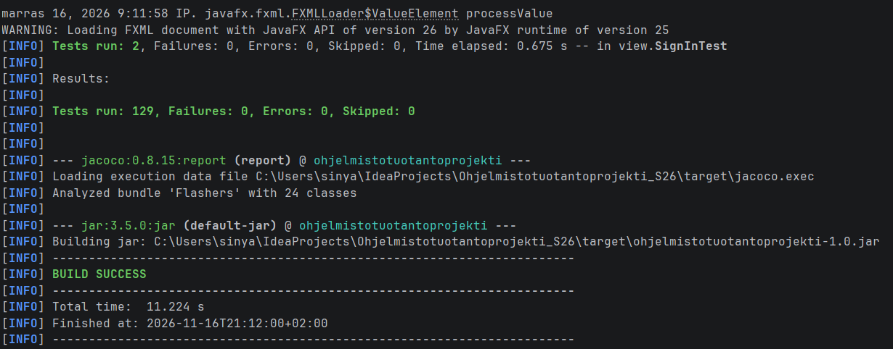

# Sprint 6 review report

## Sprint Goal
The goal for this sprint was database localisation, documentation and code clean-up.

## Completed User Stories / Tasks
- Database localisation
  - Translation table was added to database for database localisation
- Architecture Design Documentation
  - Class, use case and sequence diagrams for this projects were added to documents folder
- Statistical Code Review
  - Was done using Sonar Qube and Sonar Scanner and the report of findings was added to documents folder 
- Code Clean-Up and Refactoring
  - Code was cleaned up and everything unnecessary was removed
- Add categorization to cards
  - Flashcards now have categories
- Update Readme
  - Localisation information was added to ReadME
- Acceptance Test Planning
  - The plan for acceptance test were made and added to documents folder

## Refactored Codebase
- Added private instances of DAOs and Language Manager
- Added Loggers to replace terminal print outs and generic error handlers
- Created static Strings to replace multiple instances of messages
- Removed obsolete to-dos, imports and methods
- Cleared up names of properties and private instances
  

## What Went Well
- Good communication
- It was (mostly) clear what we needed to do
- Time management had improved

## What Could Be Improved
- We didn't really understand the database localisation --> we didn't really have anything to add there

## Time spent by each member during the sprint
| Team member     | Hours spent |
|-----------------|-------------|
| Aatu Laakso     | 20          |
| Janette Kotanen | 20          |
| Sonja Meskus    | 20          |
